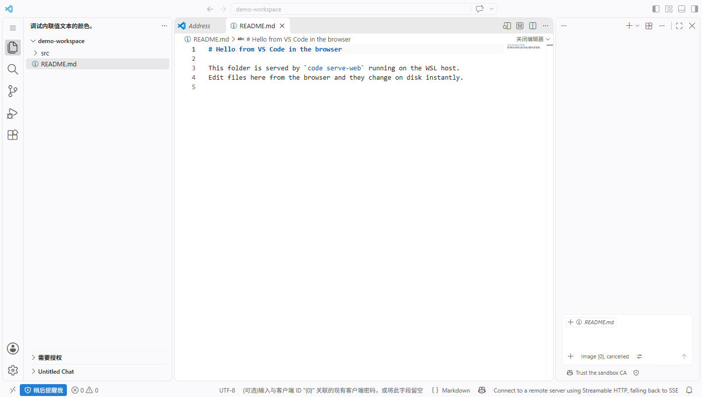
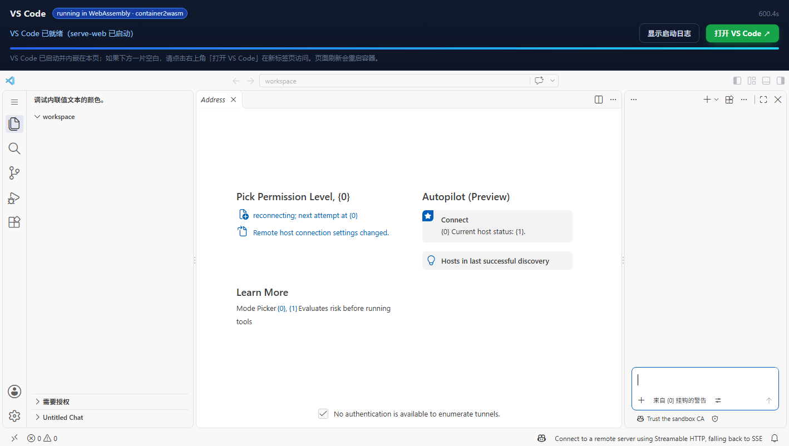

# web-vscode

[](https://github.com/FRTI64/web-vscode/actions/workflows/build.yml)

在浏览器里使用的完整 **Visual Studio Code**：

- GitHub Actions 构建一个 **内置 VS Code 的容器镜像**（`code serve-web` + 预热好的 Web Server 缓存），并推送到 GHCR；
- 本地 `docker run` / `docker compose` 启动容器，`code serve-web` 监听 `:8000`；
- 浏览器打开 <http://localhost:8000>，即可获得 VS Code 的完整工作台（文件树、编辑器、集成终端、扩展、设置同步等）。



> 截图：`code serve-web` 在本地运行，Chrome 通过 `http://localhost:8000` 打开后编辑挂载目录中的文件（截图为真实运行截图）。

---

## 工作原理

```text
┌─────────────────────────── GitHub Actions (ubuntu-24.04) ───────────────────────────┐
│  docker build                                                                        │
│    1. 下载 VS Code CLI（固定 commit）                                                  │
│    2. 预热 $HOME/.vscode/cli/serve-web/<commit>（下载 ~270 MB Web Server，构建进镜像） │
│    3. docker push → ghcr.io/frti64/web-vscode:latest / :sha-xxxxxxx                   │
│    4. 起容器做冒烟测试：curl :8000 必须返回 VS Code workbench HTML（非 root 运行）      │
└──────────────────────────────────────────────────────────────────────────────────────┘
                                        │
                   docker run -p 8000:8000 -v ./workspace:/workspace
                                        ▼
                    code serve-web --host 0.0.0.0 --port 8000
                                        │
                        浏览器 http://localhost:8000
```

- 镜像里的 VS Code 版本固定为 `1.146.0`（commit `69047191f`），Web Server 在构建阶段已下载并快照进镜像，因此容器启动后**不需要再联网下载**（启动到可用的时间通常在 1 分钟内）。
- 容器默认以非 root 用户 `coder`（uid 1000）运行，工作目录挂载到 `/workspace`。

## 快速开始

### 方式一：使用 GitHub Actions 构建好的镜像（推荐）

镜像已发布到公开的 GHCR，可直接拉取（若之后改为私有包，需 `docker login ghcr.io`，PAT 要带 `read:packages`）：

```bash
docker run --rm -p 8000:8000 \
  -v "$PWD/workspace:/workspace" \
  ghcr.io/frti64/web-vscode:latest
```

然后浏览器打开 <http://localhost:8000>。

### 方式二：本地构建（不需要先跑 CI）

```bash
git clone https://github.com/FRTI64/web-vscode.git
cd web-vscode
mkdir -p workspace

docker compose up --build
# 或者不用 compose：
# docker build -t web-vscode .
# docker run --rm -p 8000:8000 -v "$PWD/workspace:/workspace" web-vscode
```

### 方式三：没有 Docker，直接在 Linux 主机上跑

```bash
./scripts/serve-local.sh
# 等价于手动执行 code serve-web，首次运行会下载 ~270 MB 的 Web Server 并缓存
```

常用覆盖变量：

```bash
PORT=8080 CONNECTION_TOKEN="$(openssl rand -hex 16)" ./scripts/serve-local.sh
```

浏览器打开脚本打印的 `Web UI available at ...` 地址即可（设置了 `CONNECTION_TOKEN` 时 URL 会带 `?tkn=...`）。

## GitHub Actions

工作流：`.github/workflows/build.yml`（`build-vscode-web-image`）

| 触发 | 行为 |
| --- | --- |
| push 到 `main` / tag `v*` | build → push 到 `ghcr.io/frti64/web-vscode` → 冒烟测试 |
| pull_request | build（不 push）→ 用本地镜像做同样的冒烟测试 |
| 手动 `workflow_dispatch` | 同上（push 路径），适合验证版本变更 |

手动触发：

```bash
gh workflow run build.yml -R FRTI64/web-vscode
gh run watch -R FRTI64/web-vscode
```

### 构建产物（已在本仓库的 GitHub Actions 中真实构建并验证）

| 项目 | 值 |
| --- | --- |
| GitHub Actions | <https://github.com/FRTI64/web-vscode/actions/workflows/build.yml> |
| GHCR 包（公开，可匿名 pull） | <https://github.com/FRTI64/web-vscode/pkgs/container/web-vscode> |
| 镜像 | `ghcr.io/frti64/web-vscode:latest`（每次构建另有 `:sha-<commit>`，如 `:sha-c688d6f`） |
| 压缩后大小 | 334.8 MiB（4 层，linux/amd64） |
| 构建耗时 | 首次约 1 分 45 秒（含下载 270 MB Web Server 并预热缓存），之后命中 GHA 缓存约 35 秒 |
| 冒烟测试 | HTTP 200 / `text/html` / body 含 `vscode` / 运行用户 `coder`（uid 1000）✅ |

每次构建的 manifest digest 会写入该次 run 的 Job Summary（OCI label 里的 `created` 时间戳每次构建都会变，所以 digest 每次不同）。

冒烟测试会验证：

1. 容器能启动，并在超时前响应 HTTP 200；
2. 返回的是 VS Code workbench HTML（`text/html` 且包含 `vscode`）；
3. 容器以非 root 用户（`coder`, uid 1000）运行；
4. 失败时自动导出 `docker logs` 便于排查。

镜像标签：`latest`（默认分支）、`sha-<short>`（每次构建）、`vX.Y.Z`（打 tag 时）。

## 配置（容器环境变量）

| 变量 | 默认值 | 说明 |
| --- | --- | --- |
| `PORT` | `8000` | `code serve-web` 监听端口 |
| `HOST` | `0.0.0.0` | 监听地址（容器内需要 0.0.0.0） |
| `CONNECTION_TOKEN` | 空 | 设置后所有请求需要 `?tkn=<token>` 或对应 Cookie；留空则用 `--without-connection-token` |
| `DEFAULT_FOLDER` | `/workspace` | 浏览器连接后默认打开的工作区 |
| `VSCODE_COMMIT` | 镜像内固定 commit | 指定 `code serve-web` 运行的 VS Code commit（需与镜像内缓存一致） |
| `SERVER_DATA_DIR` | `/home/coder/.vscode-serve-web-data` | VS Code Server 的用户数据目录 |

示例：带访问令牌 + 挂载自己的工作区

```bash
docker run --rm -p 8000:8000 \
  -e CONNECTION_TOKEN="$(openssl rand -hex 16)" \
  -e DEFAULT_FOLDER=/workspace \
  -v "$HOME/projects/demo:/workspace" \
  ghcr.io/frti64/web-vscode:latest
```


## WebAssembly 版本：容器直接在浏览器里运行

[`wasm-demo/`](wasm-demo/README.md) 提供了「把本镜像转成 WebAssembly、在浏览器里自动加载并访问其中的 VS Code」的完整方案：

- 用 container2wasm 的 `c2w --to-js` 把 `ghcr.io/frti64/web-vscode:latest` 转成 `out.js` + QEMU wasm + 1.07 GB 的容器 rootfs 数据；
- 一个自动加载页面在浏览器里启动这个 wasm 容器（x86_64 全模拟），容器里跑起 `code serve-web`；
- 页面通过同源反向代理把容器中的 VS Code 工作台内嵌显示，也可以在新标签页打开 `http://localhost:18080/`。



```bash
cd wasm-demo
./scripts/fetch-static-cache.sh   # 可选但建议：VS Code Web 客户端静态资源（~270 MB），大幅加速加载
./scripts/serve.sh                # 自动下载 GitHub Actions 里的 wasm 产物与 c2w-net
# 打开 http://localhost:8091/ ，首次引导约 8-10 分钟
```

已知限制：首次启动慢（全模拟 x86_64）、内存占用大、建议单用户/单标签页使用；详情与踩坑记录见
[`wasm-demo/README.md`](wasm-demo/README.md)。

## 目录结构

```text
.
├── .github/workflows/build.yml   # CI：build → push GHCR → 冒烟测试
├── Dockerfile                    # 含 VS Code CLI + 预热 Web Server 缓存的镜像
├── entrypoint.sh                 # 容器入口：拼装 code serve-web 参数并 exec
├── docker-compose.yml            # 本地一键启动
├── scripts/
│   ├── serve-local.sh            # 不用 Docker，直接在 Linux 主机跑 serve-web
│   ├── smoke-test.sh             # 轮询 serve-web 直到 workbench 可用
│   └── ci-smoke.sh               # CI 中的容器冒烟测试脚本
├── docs/screenshot.png
├── wasm-demo/                    # container2wasm：在浏览器里运行本镜像的 WebAssembly 版本
└── workspace/                    # compose 挂载进容器的示例工作区
```

## 安全与许可

- 该容器默认 **没有身份认证**（`--without-connection-token`）。仅建议在本机 / 受信网络使用；对外暴露时请设置 `CONNECTION_TOKEN`，或放在反向代理 / Tailscale / Cloudflare Tunnel 之后并加认证。
- 打开的工作区目录会暴露给能访问端口的人，请只挂载你允许对方编辑的目录。
- 使用本项目会在构建／运行 VS Code Server 时接受 [Visual Studio Code Server License Terms](https://aka.ms/vscode-server-license) 与 Microsoft 隐私声明；VS Code 本体与 Server 由 Microsoft 提供，本项目只包含构建与运行脚本。
- 容器内的 VS Code 以非 root 用户运行，工作目录 `chown` 给该用户；挂载宿主机目录时注意文件权限。

## 常见问题

- **浏览器一直显示 "downloading, please wait"（HTTP 202）**：正在下载/解压 Web Server。镜像已预热，正常不应出现；裸机 `serve-local.sh` 首次运行需要等待约 270 MB 下载。
- **端口被占用**：改用 `-p 8080:8000`、`PORT=8080` 或 `docker compose` 里调整映射。
- **浏览器提示证书/沙箱相关告警**：VS Code Web 使用 Service Worker 等浏览器能力，开发用途下可忽略；部分企业代理环境需在浏览器允许 `localhost` 的 WebSocket。
- **无法访问扩展市场 / 无法登录**：检查容器到外网的网络与代理；`code serve-web` 的扩展安装与登录依赖微软服务。

## License

构建脚本与文档代码以 MIT 方式提供（见仓库约定）；VS Code、VS Code Server 及其组件版权归 Microsoft，受其自身许可条款约束。
