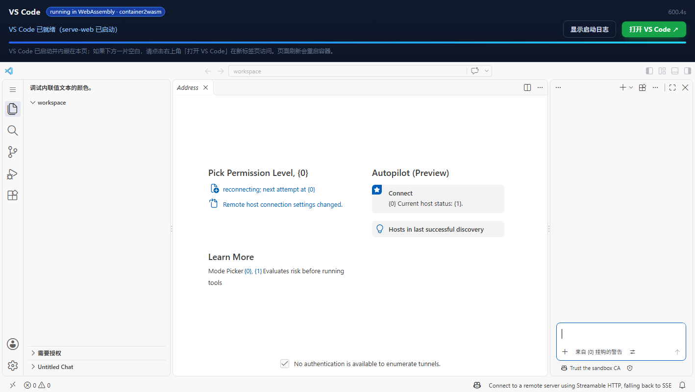

# 把 web-vscode 容器转成 WebAssembly，在浏览器里自动加载并访问 VS Code

这个目录把 [`ghcr.io/frti64/web-vscode`](https://github.com/FRTI64/web-vscode/pkgs/container/web-vscode)（内含 VS Code + `code serve-web` 的容器镜像）通过 [container2wasm](https://github.com/container2wasm/container2wasm) 的 `c2w --to-js` 转换成 **WebAssembly**：

- 一个静态网页自动加载 wasm 容器（QEMU x86_64 全模拟 + 1.1 GB 的容器 rootfs）；
- 容器在浏览器里启动 Debian + `entrypoint.sh` + `code serve-web`；
- 页面通过同源反向代理把容器里 `:8000` 的 VS Code 工作台**内嵌**到本页，也可在新标签页打开 `http://localhost:18080/`。



> 上图为**真实运行截图**（Chrome，2026-11-12）：页面自动加载 1 GB+ 的 wasm 容器，容器内 `code serve-web` 启动后，
> 页面通过 `/vs/` 同源反向代理把 VS Code 工作台内嵌显示。查看 VS Code 工作台原始截图见
> [docs/vscode-in-browser.png](docs/vscode-in-browser.png)。

---

## 精简版：OpenVSCode Server + 全内存管线（更快 / 更省流量）

根目录的 `serve-web` 镜像为 335 MB（压缩），转 wasm 后浏览器首载约 1.1 GB（gzip/zstd 后约 0.36-0.39 GB）。为了把
启动压到分钟级、下载压到 0.1 GB 级，本仓库另外提供 [`wasm-openvscode/`](../wasm-openvscode/README.md)：

- **更小的输入镜像**：Debian slim + OpenVSCode Server 官方 tarball，压缩后仅 **111 MB**（vs 335 MB）；
  没有微软 Rust CLI 包装层，guest 里直接由 node server 启动（CLI 是旧方案 9 分钟启动的主要开销）。
- **全内存管线**（本目录服务端默认开启）：
  - `--memory`：把 `out.js` / `.wasm` / `.data` 一次性读入 Node 内存，请求期间零磁盘 I/O；
  - `--compress-data`：启动时在内存里 gzip，浏览器以 `Content-Encoding: gzip` 下载、在内存解压；
  - 页面与 wasm 运行时都只在内存中工作，不写 IndexedDB / OPFS / 磁盘；
  - guest 的 rootfs 在 wasm 内存里，`/tmp` 是内存盘（HOME、VS Code 数据、工作区都在 `/tmp`），
    编辑/终端写入不会落到任何磁盘（刷新页面即恢复初始状态）。
- **客户端静态资源宿主直出**：`/stable-<commit>/static/...` 由宿主 cache 直接返回，只有动态请求走模拟 guest。

```bash
cd wasm-demo

# 1) 宿主侧 OpenVSCode 客户端资源（~74 MB，建议）
./scripts/fetch-openvscode-cache.sh

# 2) 启动（自动下载 wasm 产物 c2w-web-vscode-ovs-wasm + c2w-net）
./scripts/serve-openvscode.sh

# 3) 打开脚本打印的地址（默认如下），等待容器在浏览器里启动
#    http://localhost:8092/?net=delegate=ws://127.0.0.1:8889&port=18081
```

`MEMORY=0` / `COMPRESS_DATA=0` 可以关闭内存模式 / 压缩（用于对比）。

> 实测数据（详见文末「测量记录」）：待补充。

## 架构

```text
┌─────────────── GitHub Actions ───────────────┐
│ ① web-vscode 仓库: build container image      │
│ ② frti64_c2w 仓库: c2w --to-js 把镜像转成      │
│    out.js + qemu-system-x86_64.wasm + .data   │
│    产物作为 GitHub Actions artifact 上传       │
└───────────────────────┬───────────────────────┘
                        │ artifact（~397 MB zip / ~1.1 GB 解压）
                        ▼
┌──────────────────── 本地 Linux (WSL2) ────────────────────┐
│  ./scripts/serve.sh                                        │
│    ├─ node web/server.mjs  页面 + COOP/COEP + /vs/ 反向代理 │
│    └─ c2w-net              宿主侧网络栈，:18080 → guest:8000│
│                                                            │
│  浏览器 http://localhost:8091/                              │
│    └─ QEMU-Wasm 启动容器（x86_64 模拟，首次约 8-10 分钟）    │
│         └─ 容器内 entrypoint → code serve-web (:8000)       │
│    └─ 页面把 /vs/ 代理到 guest:8000 → iframe 内嵌 VS Code   │
└────────────────────────────────────────────────────────────┘
```

## 已验证的结果（2026-11-12）

| 项目 | 结果 |
| --- | --- |
| 容器镜像 | `ghcr.io/frti64/web-vscode:latest`，由 [web-vscode CI](https://github.com/FRTI64/web-vscode/actions/workflows/build.yml) 构建并冒烟测试 |
| wasm 转换 | [container2wasm run](https://github.com/FRTI64/frti64_c2w/actions/runs/43176341100) ✅，`build_seconds=1701`（约 28 分钟），产物 397 MB（zip） |
| wasm 产物 | `out.js` 278 KB / `qemu-system-x86_64.wasm` 41 MB / `qemu-system-x86_64.data` 1.07 GB（容器 rootfs + 内核 + VM 状态） |
| 容器引导 | 浏览器内 QEMU 启动后约 **10 秒**看到容器 entrypoint 日志（Debian + tini + entrypoint） |
| `code serve-web` 就绪 | 约 **8-9 分钟**（x86_64 全模拟下 Node 启动很慢，guest 只有 1 vCPU） |
| 首个 HTTP 请求 | 50-100 秒，之后约 14-20 秒（TCG JIT 预热后变快） |
| 内嵌 VS Code | 静态资源从宿主 cache 提供后，首次 `/vs/` 代理请求约 50-60 秒，之后工作台加载完成并显示 Explorer/Welcome/Chat 页（截图见上） |
| 端到端实测 | 页面加载 → 容器引导 10s → `serve-web` 就绪 **541s** → 内嵌工作台可交互；完整验证记录见 `docs/validation-summary.json` |

> 说明：宿主侧把 VS Code 的静态客户端文件（`out/`、`extensions/`、`resources/` 等，约 738 MB）缓存目录用于直出，只有动态请求走模拟 guest，所以工作台首次渲染很快；否则每个几百 KB 的 JS 都要经过模拟网络，会慢到不可用。

## 快速开始

前置条件：Linux（`c2w-net` 目前只在 Linux 上测试过，WSL2 可用）、`node >= 18`、`curl`/`tar`；可选 `gh` CLI（用于自动下载 Actions 产物）。浏览器需要支持 SharedArrayBuffer（Chrome/Edge，页面已带 COOP/COEP 头）。

```bash
cd wasm-demo

# 1) 下载 VS Code Web 客户端静态资源（~270 MB，强烈建议，否则工作台加载极慢）
./scripts/fetch-static-cache.sh

# 2) 启动：自动下载 wasm 产物（GitHub Actions artifact）+ c2w-net，然后起页面服务
./scripts/serve.sh

# 3) 浏览器打开
#    http://localhost:8091/
#    等待 8-10 分钟（引导容器 + VS Code server），就绪后页面内嵌 VS Code；
#    右上角「打开 VS Code」可新标签页直达 http://localhost:18080/
```

没有 `gh` 时，手动把 GitHub Actions run 里的 artifact `c2w-web-vscode-wasm` 解压到 `wasm-demo/htdocs/`，再运行 `serve.sh` 即可。

### 可选环境变量

| 变量 | 默认值 | 说明 |
| --- | --- | --- |
| `PAGE_PORT` | `8091` | 页面/静态服务端口 |
| `GUEST_PORT` | `18080` | 宿主侧转发到 guest `:8000` 的端口（也用于「打开 VS Code」直链） |
| `WS_PORT` | `8888` | `c2w-net` 的 WebSocket 端口，页面里的 wasm 通过它联网 |
| `STATIC_CACHE` | `.cache/serve-web/<commit>` | VS Code Web 客户端缓存目录（可关闭：设为空目录不存在即可） |
| `C2W_NET` | `.bin/c2w-net` | `c2w-net` 二进制路径（缺省自动下载 container2wasm v0.8.5 release） |
| `ARTIFACT_RUN` | 最近一次 | 指定下载产物的 GitHub Actions run id |
| `SKIP_DOWNLOAD` | `0` | `1` 表示产物缺失时直接报错，不自动下载 |

## 重新生成 wasm 产物

产物由 GitHub Actions 里的 container2wasm 工作流生成（本仓库的 `web-vscode` 镜像只是一个输入）：

```bash
gh workflow run build.yml -R FRTI64/frti64_c2w \
  -f source=registry \
  -f image=ghcr.io/frti64/web-vscode:latest \
  -f arch=amd64 \
  -f output_kind=to-js \
  -f kernel=mainline \
  -f name=web-vscode-wasm \
  -f guest_ram=1024
```

构建约 30 分钟，完成后 artifact 名为 `c2w-web-vscode-wasm`。改了容器镜像后，用新镜像重新跑一次即可。

## 实现要点（踩坑记录）

1. **页面必须是 cross-origin isolated**：QEMU-Wasm 用 `SharedArrayBuffer` 与 worker 通信，页面和所有资源响应都要带
   `Cross-Origin-Opener-Policy: same-origin` + `Cross-Origin-Embedder-Policy: require-corp`，否则报
   `DataCloneError: SharedArrayBuffer transfer requires self.crossOriginIsolated`。
2. **内嵌 iframe 也要带 COEP**：顶层页面 COI 后，Chrome 要求被 iframe 的文档同样带 COEP（否则
   `net::ERR_BLOCKED_BY_RESPONSE` / `coep-frame-resource-needs-coep-header`），所以 `/vs/` 代理响应也要补上这两个头。
3. **`c2w-net -p` 的参数顺序**：Go `flag` 在第一个位置参数后停止解析，所以必须写成
   `c2w-net -p 18080:8000 --listen-ws 127.0.0.1:8888`（flag 都在地址前），否则端口转发不生效。
4. **浏览器 → 容器端口**：容器里的 `code serve-web` 监听 guest `:8000`，宿主用 `c2w-net -p 18080:8000` 监听；
   页面上的就绪检测通过服务端 `GET /__status`（Node 侧探测）完成，避免浏览器跨域/COEP 限制。
5. **静态资源加速**：VS Code 客户端的大部分文件与镜像里 `code serve-web` 的缓存完全一致，因此可以在宿主侧直出
   （`--static-cache`），把 `/stable-<commit>/static/...` 请求从模拟 guest 手里接管。
6. **Guest 根文件系统只读**：c2w 启动参数里 `root=/dev/vda ... ro`，VS Code server 写 `/home/coder` 等路径会报
   `EACCES`/`ReadRemoved` 警告，但 workbench 基本功能（Explorer/Welcome/编辑器）仍可用；需要持久化时考虑给容器
   增加可写 tmpfs/overlay（或在镜像里把相关目录指向 tmpfs）。
7. **性能/内存**：x86_64 全模拟很慢（guest 1 vCPU，Node 启动约 8 分钟）；1.07 GB `.data` + 1 GB guest RAM +
   QEMU TCG 缓存对浏览器是大内存占用。建议单标签页、单用户使用；页面刷新会重启整个容器。
   压力测试中（多个标签页/反复重载）曾观察到 wasm `memory access out of bounds` 崩溃 —— 重新打开页面即可恢复。

## 目录结构

```text
wasm-demo/
├── web/
│   ├── index.html          # 自动加载 wasm 容器 + 内嵌 VS Code 的页面
│   ├── server.mjs          # 静态服务 + COOP/COEP + /__status + /vs/ 反向代理
│   └── vendor/             # xterm / xterm-pty（容器控制台输出与输入）
├── scripts/
│   ├── serve.sh            # 一键：下载产物、起 c2w-net、起页面服务
│   └── fetch-static-cache.sh  # 可选：下载 VS Code Web 客户端静态资源（~270 MB）
├── docs/vscode-in-browser.png
├── htdocs/                 # 运行时生成（artifact + 页面），已 gitignore
└── .bin/ .cache/           # 运行时生成（c2w-net / 静态缓存），已 gitignore
```

## 许可

页面与脚本遵循本仓库的 MIT 许可；容器镜像内以及本次下载的 VS Code / VS Code Server 组件版权归 Microsoft，
受其自身许可条款约束（构建时已接受 VS Code Server License Terms）。container2wasm 遵循其上游许可。
